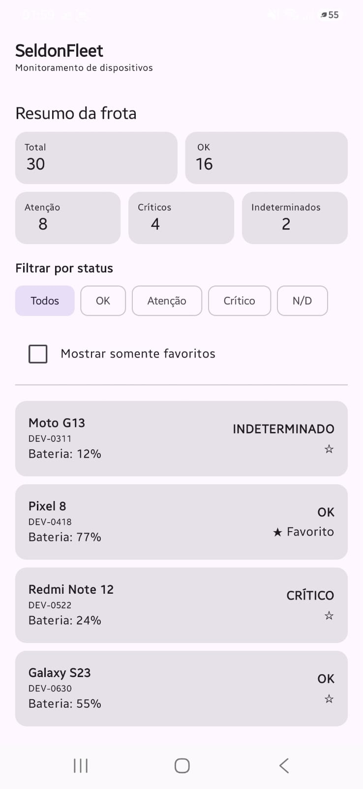
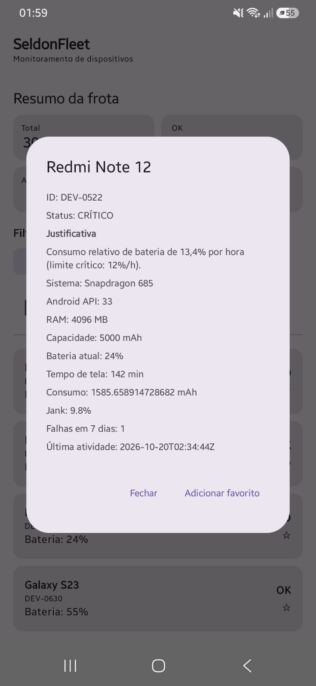

# SeldonFleet — Monitoramento de dispositivos Android

Aplicativo Android desenvolvido em Kotlin e Jetpack Compose para monitorar uma frota de dispositivos a partir de um arquivo JSON local, classificar seu estado e permitir a consulta dos dados de cada aparelho.

## Objetivo

O projeto faz parte de um desafio técnico que avalia desenvolvimento Android, separação de responsabilidades, tratamento de dados incompletos, testes automatizados e integração contínua.

## Tecnologias utilizadas

- **Kotlin** — linguagem principal.
- **Jetpack Compose** — construção da interface.
- **Android Assets** — leitura local do arquivo `frota.json`.
- **JUnit** — testes unitários da regra de classificação.
- **GitHub Actions** — execução automatizada de verificações.

## Funcionalidades implementadas

- Leitura local dos 30 dispositivos de `assets/frota.json`.
- Normalização do consumo de energia de mWh para mAh, quando há tensão nominal válida.
- Classificação dos dispositivos em OK, Atenção, Crítico ou Indeterminado.
- Exibição das contagens por status.
- Filtro de dispositivos por status.
- Consulta dos dados técnicos de cada dispositivo.
- Marcação e remoção de favoritos.
- Persistência local dos favoritos entre execuções do aplicativo.

## Regras de classificação

A classificação considera o consumo relativo de bateria por hora, a quantidade de falhas recentes e a taxa de quadros perdidos (*jank*).

| Status | Critério |
|---|---|
| Crítico | Dreno relativo ≥ 12%/h, ou pelo menos 3 falhas em 7 dias, ou jank ≥ 15% |
| Atenção | Dreno relativo ≥ 7%/h, ou pelo menos 1 falha em 7 dias, ou jank ≥ 8% |
| OK | Nenhum dos critérios de Atenção ou Crítico foi atingido |
| Indeterminado | Dados essenciais ausentes ou inválidos para calcular o dreno |

Quando um registro contém consumo em mWh, o valor é convertido para mAh utilizando a tensão nominal. Registros sem dados suficientes para calcular o dreno são tratados explicitamente.

Os critérios completos e as decisões de tratamento de dados estão descritos em [`PROTOCOLO.md`](PROTOCOLO.md).

## Resultado da classificação da frota

A validação atual do arquivo de entrada apresenta as seguintes contagens:

| Status | Quantidade |
|---|---:|
| OK | 16 |
| Atenção | 8 |
| Crítico | 4 |
| Indeterminado | 2 |
| **Total** | **30** |

## Arquitetura

O projeto separa a regra de negócio da leitura dos dados e da interface.

```text
app/src/main/
├── assets/
│   └── frota.json
└── java/com/anderson/seldonfleet/
    ├── data/
    │   ├── dto/
    │   ├── mapper/
    │   ├── repository/
    │   └── source/
    ├── domain/
    │   ├── model/
    │   ├── repository/
    │   └── usecase/
    └── MainActivity.kt
```

- **data/**: leitura do JSON, representação dos dados recebidos, conversão e implementação do repositório.
- **domain/**: modelos, contrato do repositório e regra de classificação.
- **MainActivity.kt**: interface e interação com o usuário.

A regra de classificação fica na camada de domínio e pode ser testada na JVM, sem depender da interface Android.

## Como executar

1. Instale o Android Studio.
2. Clone este repositório.
3. Abra o projeto no Android Studio.
4. Aguarde a sincronização do Gradle.
5. Execute o aplicativo em um emulador ou dispositivo Android.

O aplicativo utiliza o arquivo local `frota.json` e não precisa consultar uma API para carregar a frota.

## Testes

Para executar os testes unitários no Windows, use o terminal na raiz do projeto:

```powershell
.\gradlew.bat test
```

No Linux ou macOS:

```bash
./gradlew test
```

Os testes da regra de classificação verificam os resultados esperados para diferentes condições de telemetria. Os testes instrumentados, quando aplicáveis, devem ser executados em um dispositivo ou emulador Android.

## Capturas de tela

As capturas de tela serão armazenadas no diretório `screenshots/`.

### Lista da frota



### Detalhes do dispositivo



## Decisões e limitações conhecidas

- Os dados da frota são lidos de um arquivo local, evitando dependência de conectividade.
- Os favoritos são armazenados localmente com `SharedPreferences`.
- Registros incompletos são tratados sem assumir valores arbitrários para o consumo.
- A interface atual apresenta os detalhes em uma janela de diálogo. O requisito de navegação para uma tela de detalhes independente ainda precisa ser concluído.
- A justificativa textual que identifica o critério específico responsável pela classificação também precisa ser concluída.

## O que eu faria em seguida
- Aprimorar a explicabilidade da classificação: apresentar os valores de consumo, falhas ou jank que determinaram o status de cada dispositivo.

- Expandir a cobertura de testes: adicionar casos para os limites das regras de classificação, dados inválidos e equivalência entre consumo em mAh e mWh.
- Evoluir a navegação: avaliar a implementação de uma tela de detalhes independente, preservando os filtros aplicados ao retornar à lista.

- Melhorar a apresentação visual: aprimorar os indicadores de status e a organização das informações técnicas.

- Fortalecer a validação contínua: manter o GitHub Actions executando os testes unitários e a análise estática a cada alteração.
## Uso de inteligência artificial

Ferramentas de inteligência artificial foram utilizadas como apoio ao desenvolvimento, incluindo auxílio na elaboração e revisão de código, testes e documentação. As alterações foram aplicadas e verificadas durante a execução do projeto.

